# Expense Voucher Management System

A full-stack web application that replaces the manual expense voucher process. Employees create and submit vouchers, the Director approves or rejects them with a signature, and the Accounts Team monitors approved vouchers for reimbursement.

**Tech stack**

| Layer | Technology |
|---|---|
| Frontend | React 18 (Vite), React Router, responsive CSS, client-side form validation, protected routes |
| Backend | Node.js, Express, RESTful APIs, JWT authentication, role-based authorization |
| Database | MySQL 8 |
| File upload | Multer (signature images) |

## Table of contents
1. [Features](#features)
2. [Project structure](#project-structure)
3. [Setup instructions](#setup-instructions)
4. [Demo accounts](#demo-accounts)
5. [Application walkthrough (screenshots)](#application-walkthrough-screenshots)
6. [Voucher workflow](#voucher-workflow)
7. [Database schema](#database-schema)
8. [API documentation](#api-documentation)
9. [Validation and business rules](#validation-and-business-rules)
10. [Assumptions](#assumptions)

## Features
- **Employee:** create vouchers, save as Draft, edit or delete drafts, upload a signature, submit for approval, track status, view the rejection reason, and see a personal dashboard. Employees see only their own vouchers.
- **Director:** view all submitted vouchers, a Pending Approvals queue, search / filter / sort, approve with a signature, reject with a mandatory reason, and a dashboard with today's approvals and rejections.
- **Accounts Team:** read-only view of all submitted vouchers, search / filter / sort, view employee and director signatures, print a voucher, and a dashboard with approved totals.
- **Security:** JWT login, role-based API authorization, protected frontend routes, bcrypt password hashing, upload type and size limits.
- **Automatic voucher numbers** in the form `EV-2026-00001`, unique and generated safely inside a database transaction.

## Project structure
```
expense-voucher-system/
├── backend/
│   ├── db/schema.sql            # database schema / migration
│   ├── src/
│   │   ├── routes/              # auth, vouchers, dashboard
│   │   ├── middleware/          # JWT auth + roles, file upload
│   │   ├── migrate.js           # applies schema.sql
│   │   ├── seed.js              # demo users
│   │   └── server.js
│   ├── uploads/                 # signature images (git-ignored)
│   └── .env.example
├── frontend/
│   ├── src/pages/               # Login, Dashboard, VoucherList, VoucherForm, VoucherDetails
│   ├── src/components.jsx       # layout, protected routes, badges
│   └── .env.example
├── screenshots/
└── README.md
```

## Setup instructions

**Prerequisites:** Node.js 18+ and MySQL 8 running locally.

### 1. Backend
```bash
cd backend
npm install
cp .env.example .env        # Windows: copy .env.example .env
```
Edit `backend/.env` and set `DB_PASSWORD` (your MySQL password) and `JWT_SECRET` (any long random string). Then:
```bash
npm run migrate             # creates the database and tables from db/schema.sql
npm run seed                # creates the demo users
npm run dev                 # API on http://localhost:5000
```
You can also run `backend/db/schema.sql` directly in MySQL Workbench or the `mysql` CLI instead of `npm run migrate`.

### 2. Frontend
Open a second terminal:
```bash
cd frontend
npm install
cp .env.example .env        # VITE_API_URL=http://localhost:5000
npm run dev                 # App on http://localhost:5173
```

### Environment variables (`backend/.env.example`)
| Variable | Purpose |
|---|---|
| `PORT` | API port (default 5000) |
| `CLIENT_URL` | Allowed frontend origin for CORS |
| `DB_HOST`, `DB_PORT`, `DB_USER`, `DB_PASSWORD`, `DB_NAME` | MySQL connection |
| `JWT_SECRET`, `JWT_EXPIRES_IN` | Token signing key and lifetime |

## Demo accounts
Password for all accounts: `Password@123`

| Role | Email |
|---|---|
| Employee | `employee1@example.com`, `employee2@example.com` |
| Director | `director@example.com` |
| Accounts | `accounts@example.com` |

## Application walkthrough (screenshots)

### 1. Employee creates a voucher
The employee fills in department, expense date, title, category, amount and description, and uploads a signature. A previously saved signature is reused automatically.

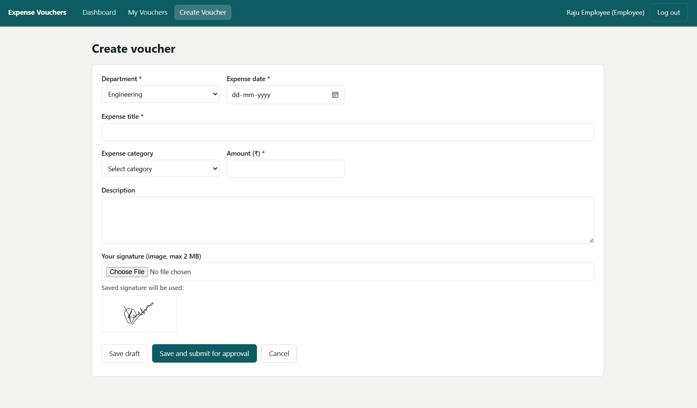

### 2. Draft voucher
A new voucher is saved as **Draft** with an auto-generated number. While in Draft, the employee can edit it, delete it, or submit it for approval.

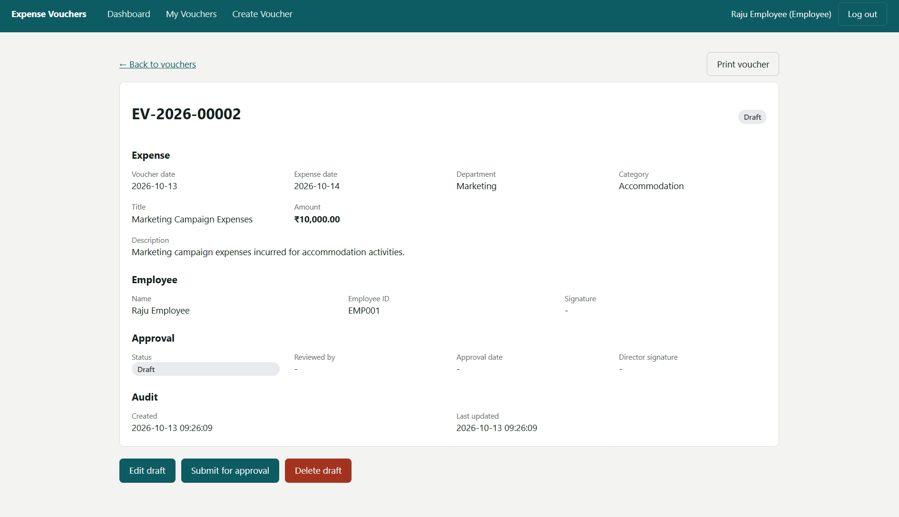

### 3. Submitted voucher (Pending Approval)
After submission the voucher becomes read-only for the employee and its status changes to **Pending Approval**.

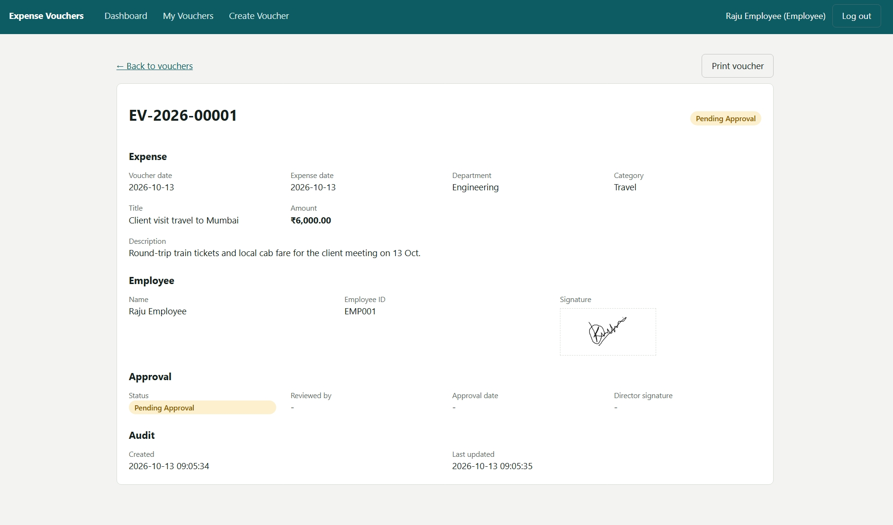

### 4. Employee dashboard and My Vouchers
The dashboard shows the employee's own totals: total vouchers, drafts, pending, approved, rejected and the total amount claimed. My Vouchers lists their vouchers with search, filters and sorting.

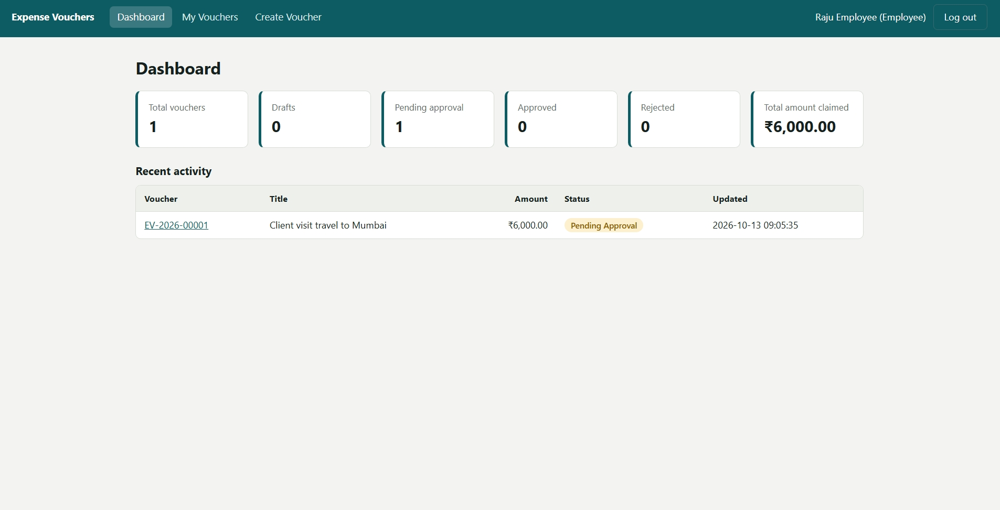

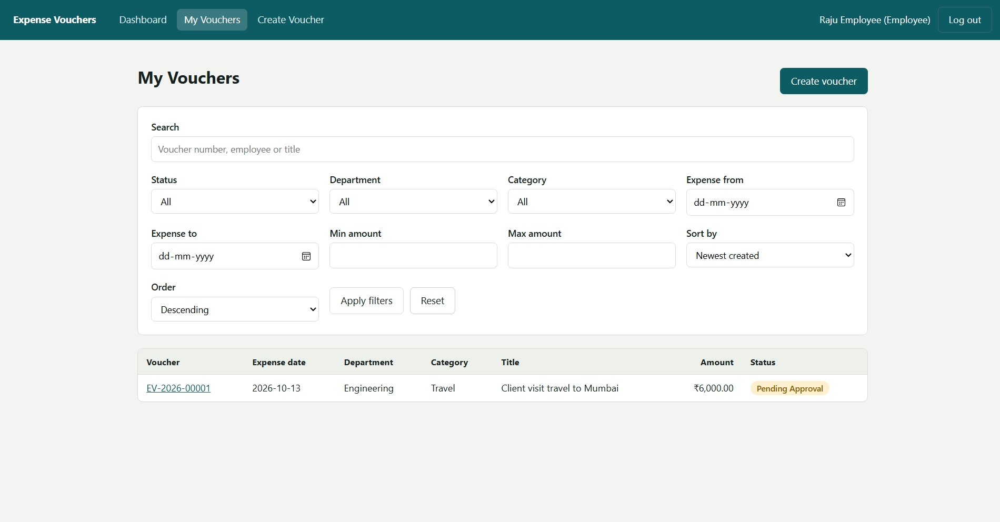

### 5. Director reviews the voucher
The Director opens a pending voucher, uploads a signature and clicks **Approve voucher**, or enters a reason and clicks **Reject voucher**. The Director cannot change the details entered by the employee.

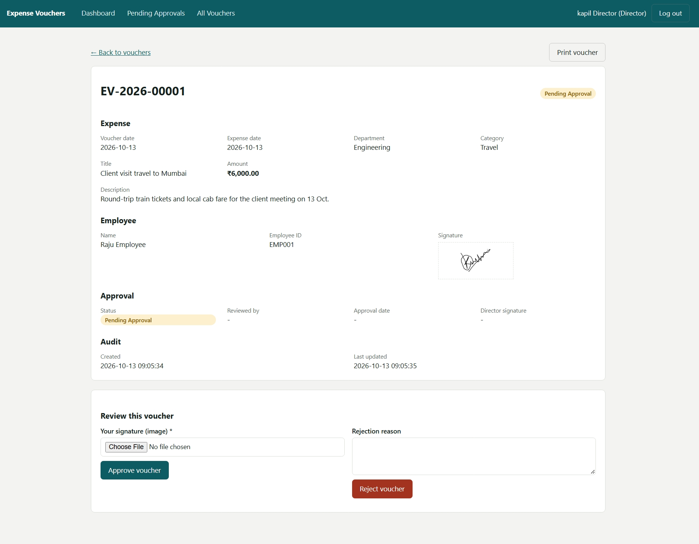

### 6. Approved voucher
An approved voucher is read-only and shows the reviewer, the approval date, and both the employee and Director signatures.

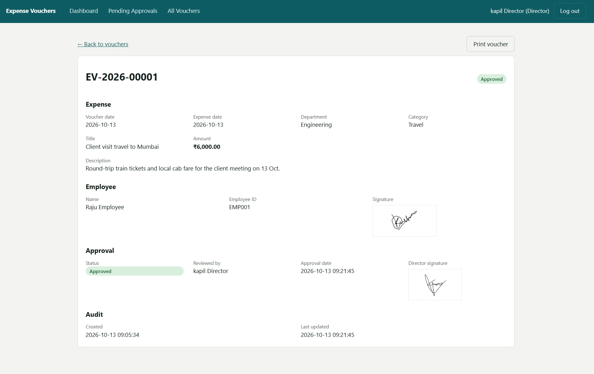

### 7. Second voucher submitted
A second voucher is submitted while the first is already approved. The employee dashboard shows 1 pending and 1 approved.

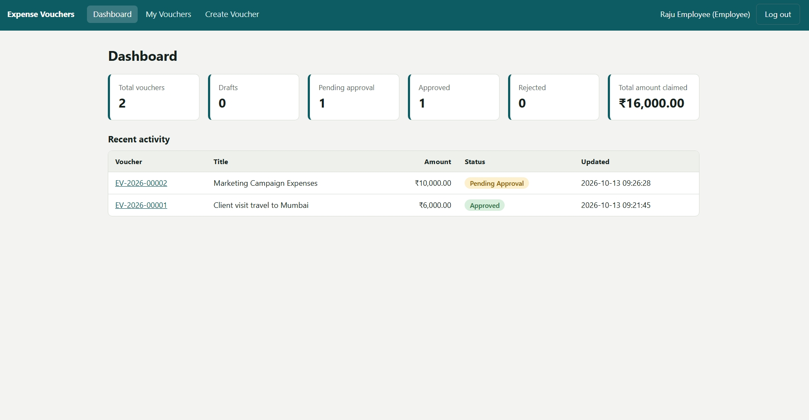

### 8. Rejected voucher
A rejection must carry a reason. It is shown on the voucher in the banner and in the Approval section (Director's view shown here), and the employee sees the same reason.

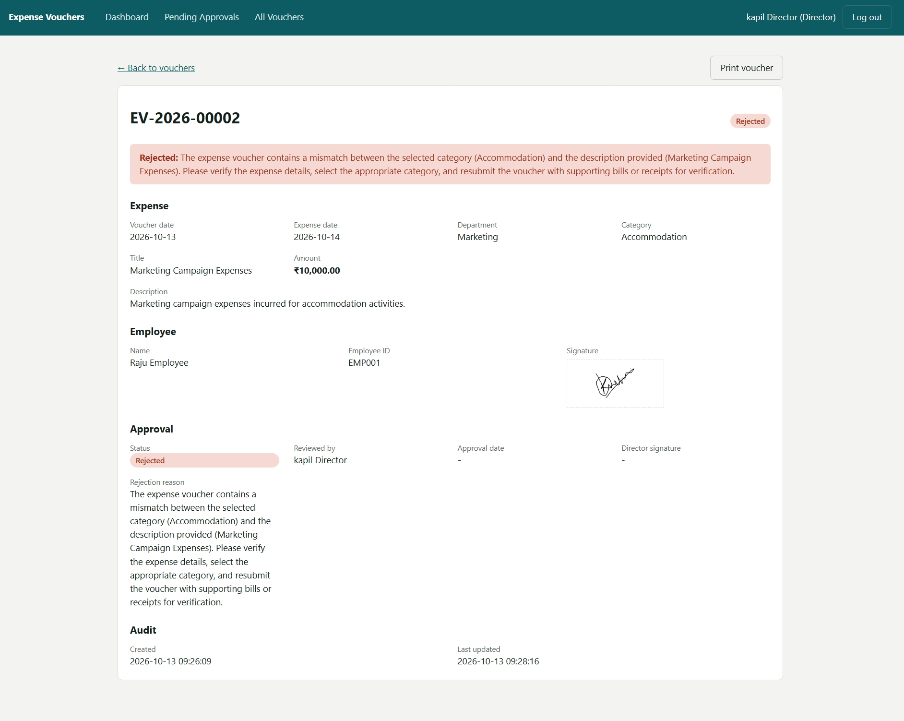

### 9. Employee dashboard after review
After the Director's decisions, the employee dashboard shows 1 approved, 1 rejected and the total amount claimed.

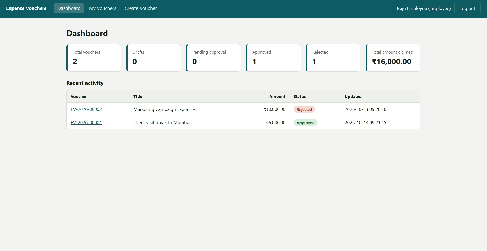

### 10. Director dashboard
The Director dashboard shows the pending approval count, approved today, rejected today, total pending amount and recent activity.

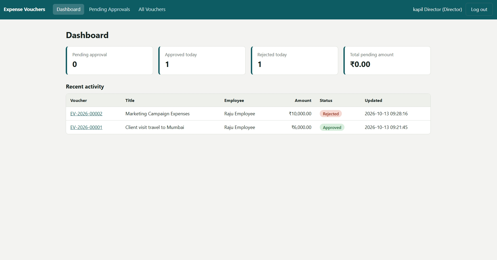

### 11. Accounts Team
The Accounts Team has a read-only view of all submitted vouchers. The dashboard shows totals and the total approved expense amount, with recent approved vouchers. All Vouchers supports search, filters and sorting.

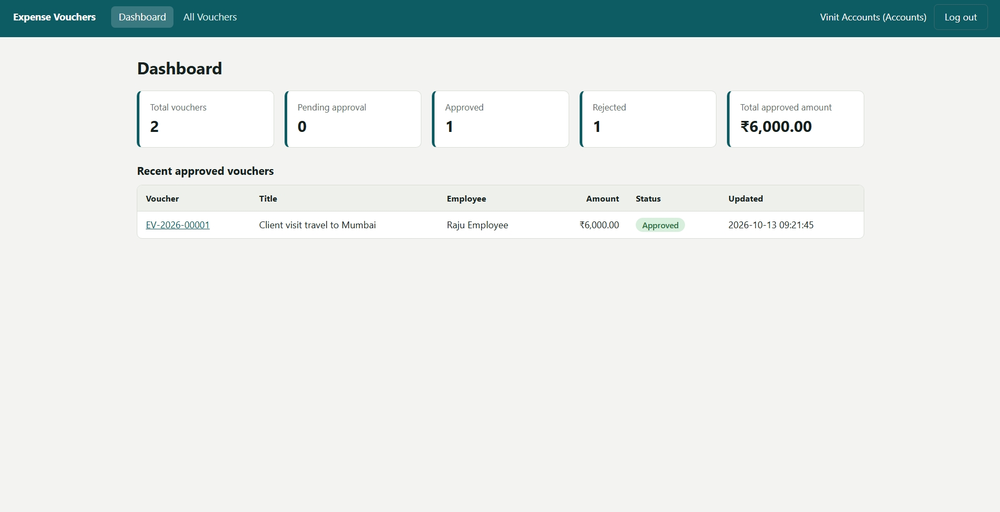

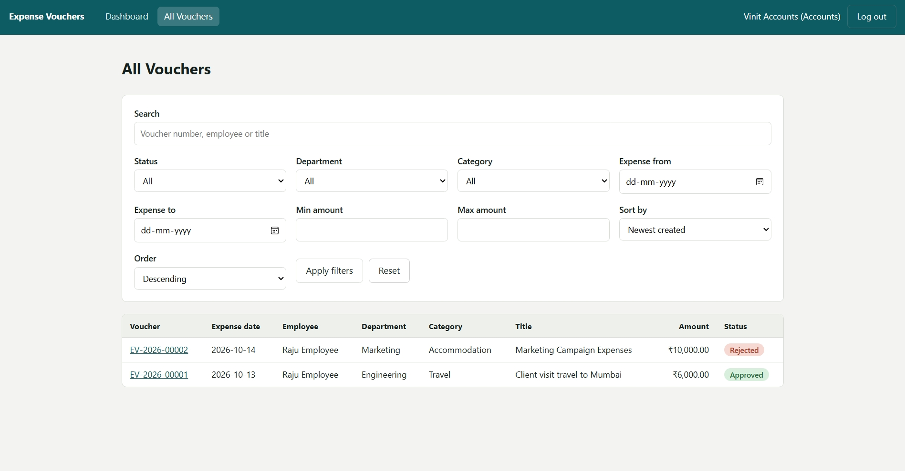

## Voucher workflow
```
Draft  ──submit──▶  Pending Approval ──┬──▶ Approved  ──▶ visible to Accounts for reimbursement
                                       └──▶ Rejected  ──▶ employee views the rejection reason
```
- Drafts can be edited or deleted only by their owner.
- Pending, Approved and Rejected vouchers are read-only.
- Only the Director can approve or reject, and only vouchers in Pending Approval.

## Database schema
Schema file: [`backend/db/schema.sql`](backend/db/schema.sql)

| Table | Purpose |
|---|---|
| `users` | Name, unique email, bcrypt `password_hash`, `role` (EMPLOYEE / DIRECTOR / ACCOUNTS), optional `employee_code`, `department`, and `signature_path` (the user's latest signature, reused automatically). |
| `voucher_sequences` | One row per year with the last used number. It is incremented inside a transaction, so voucher numbers (`EV-2026-00001`) are unique and generated automatically. |
| `vouchers` | Voucher number, owner (`user_id`), voucher and expense dates, department, title, category, description, `amount` (DECIMAL, CHECK > 0), `status` (DRAFT / PENDING / APPROVED / REJECTED), employee and director signature paths, `director_id`, `approval_date`, `rejection_reason`, `decided_at`, `created_at`, `updated_at`. Foreign keys to `users`; indexes on user, status and expense date. |

## API documentation
Base URL: `http://localhost:5000/api`. All routes except login require the header `Authorization: Bearer <token>`.

Errors return `{ "message": "...", "errors": { "field": "..." } }` with status 400 (validation), 401 (not authenticated), 403 (role or status not allowed), 404 (not found) or 409 (conflict).

| Method | Endpoint | Role | Description |
|---|---|---|---|
| POST | `/auth/login` | public | Body `{email, password}` returns `{token, user}` |
| GET | `/auth/me` | any | Current user |
| GET | `/dashboard` | any | Role-specific statistics and recent vouchers |
| GET | `/vouchers` | any | List (scoped by role). Query: `q` (voucher number / employee / title), `status`, `department`, `category`, `from`, `to` (expense date), `minAmount`, `maxAmount`, `sortBy` (date, amount, number, status, employee, updated), `order` (asc / desc) |
| GET | `/vouchers/:id` | any | Voucher details (404 if the caller may not see it) |
| POST | `/vouchers` | Employee | Create a draft. `multipart/form-data`: department, expense_date, title, amount, category?, description?, signature? (image) |
| PUT | `/vouchers/:id` | Employee | Edit own draft (same fields) |
| DELETE | `/vouchers/:id` | Employee | Delete own draft |
| POST | `/vouchers/:id/submit` | Employee | Draft to Pending Approval; requires an employee signature |
| POST | `/vouchers/:id/approve` | Director | Optional `signature` image; falls back to the saved signature, otherwise 400 |
| POST | `/vouchers/:id/reject` | Director | Body `{reason}` (required) |

Example login:
```bash
curl -X POST http://localhost:5000/api/auth/login \
  -H "Content-Type: application/json" \
  -d '{"email":"director@example.com","password":"Password@123"}'
```

## Validation and business rules
Enforced on both the frontend and the API:
- Department, Expense Title, Expense Date and Amount are mandatory; Amount must be greater than zero.
- Employee signature is mandatory before submission; Director signature is mandatory before approval.
- Rejection reason is mandatory when rejecting.
- Voucher numbers are unique and auto-generated; every new voucher starts as Draft.
- Employees can edit or delete only Draft vouchers; submitted, approved and rejected vouchers are read-only.
- Only the Director can approve or reject. Employees see only their own vouchers; Director and Accounts see all submitted vouchers.
- Uploads accept PNG, JPG, WEBP or GIF images up to 2 MB.

## Assumptions
- "Submitted" and "Pending Approval" are one step: submitting moves a voucher straight to Pending Approval.
- The Director and Accounts Team see all **submitted** vouchers (Pending, Approved, Rejected). They do not see other employees' unsent drafts.
- Rejected vouchers are final (read-only); an employee creates a new voucher to resubmit.
- A signature uploaded once is saved on the user's profile and reused for later vouchers; a new upload replaces it. Each voucher keeps its own copy of the signature path.
- Amounts are in INR (₹). Departments and categories are fixed lists in `frontend/src/constants.js`.
- Users are created by seeding; there is no self-registration or user-management screen, since the requirements do not ask for one.
- Signature images are served from `/uploads` under random filenames. For production, move them to private storage behind authenticated URLs.
- Vouchers can be printed (or saved as PDF) from the voucher details page using the browser print dialog.
